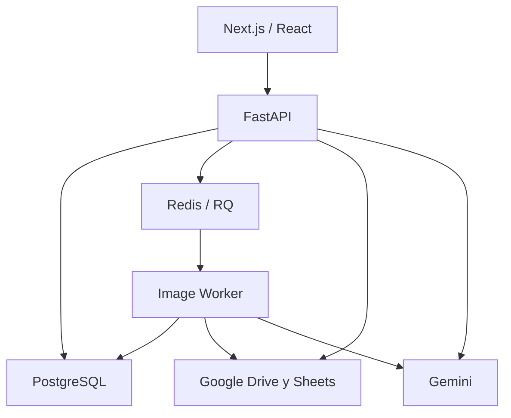

# Arquitectura activa

La limpieza parte del commit desplegado `b4aa4051cd2d1b897cc7a582e67ee8b938cfcc2b` y se desarrolla en `cleanup/remove-store-integrations-20261012`. Es una refactorización de la aplicación existente. No cambia el esquema SQL, los modelos Gemini, los prompts ni los destinos de Drive/Sheets.

| Parte | Responsabilidad | Arranque |
|---|---|---|
| Next.js | Inicio, Productos, Generar, Inventario, Más; cámara, revisión y ajustes; proxy autenticado | `Dockerfile.frontend` |
| FastAPI | OAuth Google, sesiones, permisos, catálogo SQL, análisis, coincidencias, Drive, Sheets y encolado | `service_entrypoint.py` / `studio_api.py` |
| Image Worker | Generación individual y masiva, regeneración, corrección, enriquecimiento, importación local y guardado aprobado | `catalog_platform.worker_web` → supervisor RQ |
| PostgreSQL | Productos, variantes, imágenes, jobs, lotes, sesiones, credenciales cifradas y auditoría | Instancia existente |
| Redis | Transporte de IDs de jobs y coordinación RQ | Instancia existente, noeviction |

El frontend conserva cookies HttpOnly a través del proxy del mismo origen. `SUITE_API_ORIGIN` identifica la API; `APP_PUBLIC_ORIGIN` controla las solicitudes de navegador. `IMAGE_WORKER_ORIGIN` sirve para despertar el worker. El trabajo y su estado viven en SQL: una falla de Redis no autoriza repetir una llamada pagada incierta. El supervisor mantiene heartbeat y reconcilia la entrega de jobs.

Google usa los permisos OAuth existentes. La conexión del usuario se cifra en servidor para que el worker pueda usarla sin depender de una pestaña abierta. La clave Gemini se configura desde Más → Ajustes, se cifra por usuario/carpeta y se carga de nuevo al ejecutar el job. API y worker deben conservar **la misma CREDENTIAL_ENCRYPTION_KEY existente**.

Drive mantiene las carpetas y nombres actuales. `inventario_completo`, pestaña `Lista completa`, sigue siendo el Sheet operativo. El catálogo SQL y los conteos/movimientos del Sheet tienen rutas propias; esta limpieza conserva ese comportamiento y no introduce un nuevo sincronizador.

Los únicos tipos ejecutables de job son `generation`, `studio_generation`, `asset_save`, `import` y `enrichment`. Los jobs históricos de integraciones permanecen en SQL, pero el worker los rechaza antes de cargar credenciales; reintentarlos responde 410.

WooCommerce, publicación WordPress y Loyverse no tienen clientes, rutas, webhooks, controles ni handlers activos en esta rama. Las columnas y tablas históricas permanecen. Los dos servicios Render históricos continúan con su commit anterior y no se administran desde esta entrega.

Ver [mapa de código](CODE_MAP.md), [flujo de imágenes](IMAGE_GENERATION_FLOW.md), [auditoría](INTEGRATION_REMOVAL_AUDIT.md), [variables](ENVIRONMENT_VARIABLES.md), [resultados](REGRESSION_RESULTS.md) y [rollback](../ROLLBACK.md).
